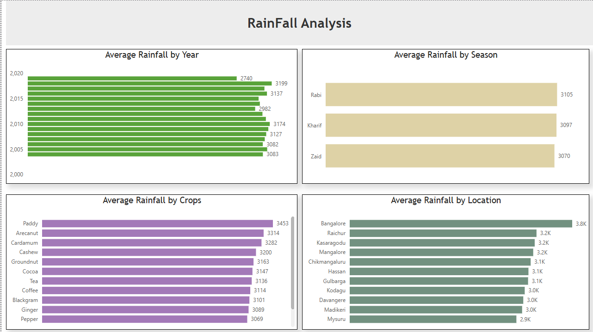
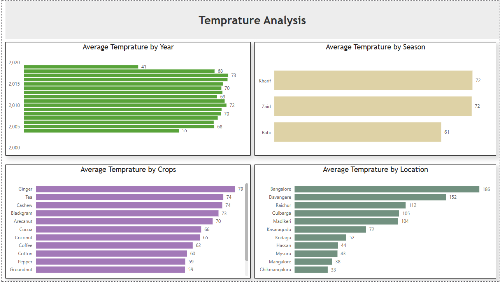
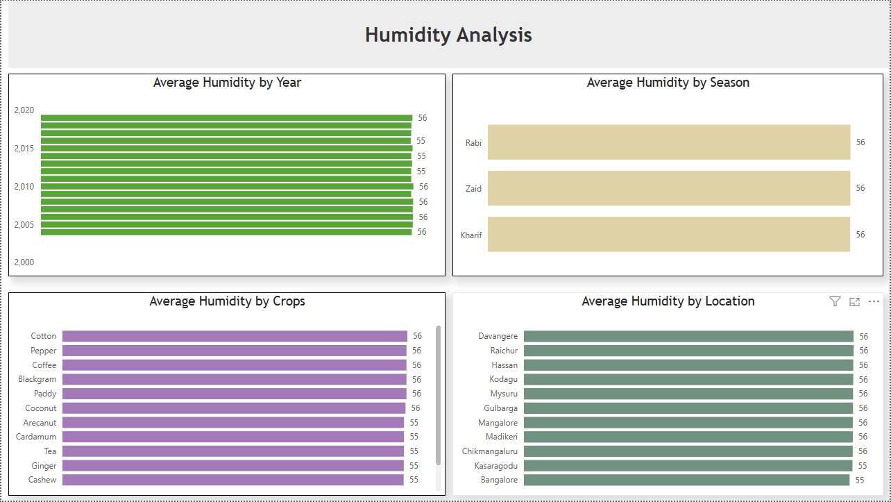
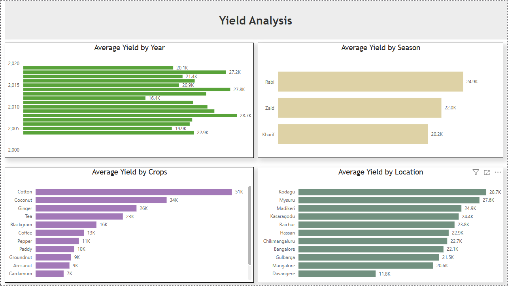

# Agriculture Analysis

Power BI analysis of agricultural and environmental data using an Azure → Snowflake → Power BI workflow.

## Project Overview

This project analyzes agricultural data across years, seasons, crops, and locations, with a focus on rainfall, temperature, humidity, and crop yield.

The analysis is presented through four Power BI dashboard pages:

- Rainfall Analysis
- Temperature Analysis
- Humidity Analysis
- Yield Analysis

## Technology Stack

- Azure
- Snowflake
- Microsoft Power BI
- CSV data source

## Dashboard Pages

### 1. Rainfall Analysis

Explores average rainfall across years, seasons, crops, and locations.



### 2. Temperature Analysis

Explores average temperature across years, seasons, crops, and locations.



### 3. Humidity Analysis

Explores average humidity across years, seasons, crops, and locations.



### 4. Yield Analysis

Explores average yield across years, seasons, crops, and locations.



## Dataset

The project uses `data_season.csv`, containing agricultural and environmental records with fields covering:

- Year
- Location
- Area
- Rainfall
- Temperature
- Soil type
- Irrigation
- Yield
- Humidity
- Crops
- Price
- Season

## Repository Structure

```text
agriculture-analysis/
├── data/
│   └── data_season.csv
├── powerbi/
│   └── Agriculture_Analysis.pbix
├── screenshots/
│   ├── rainfall-analysis.png
│   ├── temperature-analysis.png
│   ├── humidity-analysis.png
│   └── yield-analysis.png
├── .gitignore
└── README.md
```

## Data Workflow

```text
Azure → Snowflake → Power BI
```

The project demonstrates an end-to-end analytics workflow from data infrastructure and warehousing through business intelligence and visualization.
